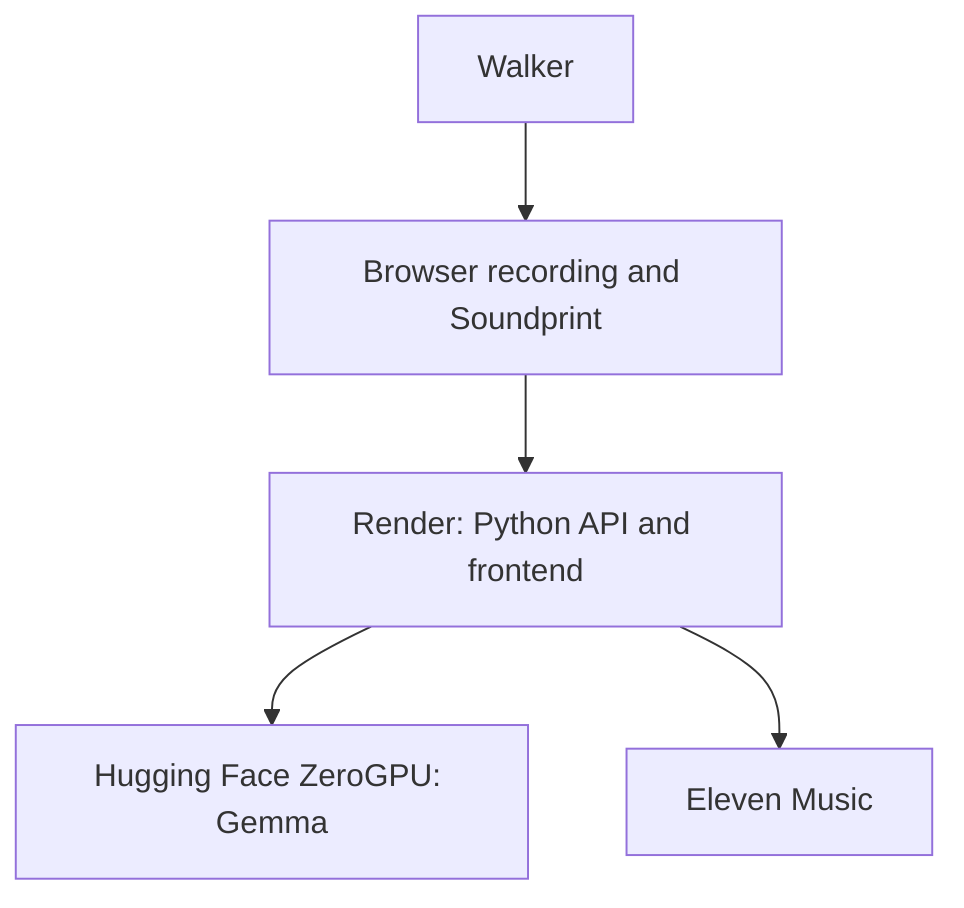

# Architecture

Footwork turns a walk into a short instrumental and a Soundprint that shows where the movement changed the music. The locked diagram is `Docs/diagrams/architecture.excalidraw`. A PNG export of that diagram is not in the repository yet.

## Context

A person walks with the browser. The browser records the walk and plays the result. One Render service runs the React app and the Python API. That API asks a Hugging Face ZeroGPU Space running Gemma for an arrangement, then asks Eleven Music to render a validated plan. Gemma receives an anonymous event timeline. It does not receive coordinates or the original clock.

## What happens to one walk

1. The browser keeps the draft on the phone. Ending the walk sends it to the API over HTTPS.
2. The API cleans the trace, detects turns, pauses, pace changes, and loops, and drops coordinates before any provider call.
3. Gemma returns a constrained arrangement. An invalid plan may be repaired once, and only when daily budget and the deadline still allow it.
4. A validated plan is the only request sent to Eleven Music. The audio is checked, then stored as a protected artifact.
5. The browser plays that audio from one clock. The route, ribbon, and current moment follow that clock.
6. If arrangement or music fails, the same timeline becomes a Route Sketch on the server. The labeled example is a separate prepared piece and is not described as a live generation.

## Daily generation budget

This tree reads four environment variables when the process starts. An empty value uses the default. A higher value is clamped to the maximum.

| Cap | Default | Maximum | Blueprint value |
|---|---:|---:|---:|
| Jobs for one installation | 8 | 8 | unset |
| Gemma attempts | 4 | 40 | 40 |
| Gemma GPU seconds | 240 | 2400 | 2400 |
| Music attempts | 6 | 40 | 40 |

Each accepted piece reserves 1 Gemma attempt, 60 GPU seconds, and 1 music attempt. The Gemma and music ceilings are shared by every caller for the UTC day. One browser installation is also limited to 8 admitted jobs that day. One generation can be active at a time. Deleting a piece does not refund the reservation. `GENERATION_ENABLED` must be the string `true` before the dispatcher calls Eleven. The blueprint still lists that flag as `false` so a full blueprint sync does not turn generation on by itself.

## Trust boundaries

- Location permission and the raw draft stay in the browser until the walk is submitted.
- Provider keys stay on the server.
- The quota ledger stores hashes, not the walk, the job key, or an install token.
- A share link is a capability for about an hour. It does not contain a location and it cannot delete the piece.
- Ready audio is removed about 60 minutes after it is ready. Ledger rows stay for 48 hours.

## Sponsors

Gemma is the open-weight arranger. Render hosts the public app and API. Eleven Music renders a validated plan into audio. CodeRabbit, Entire, DevRelay, GitHub Actions, and Excalidraw are development tools. The running app does not call them.
