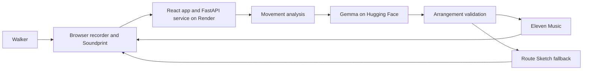

# Architecture

Footwork uses a browser, one application service, a Gemma arrangement service,
and Eleven Music. The editable diagram is
[architecture.excalidraw](diagrams/architecture.excalidraw).

## Request flow

1. The browser records location samples after permission is granted.
2. FastAPI validates the recording and passes it to the movement pipeline.
3. Python cleans the samples and detects turns, pauses, pace changes, and loops.
4. Coordinates are removed from the provider payload. Gemma receives only the
   derived event timeline.
5. Gemma returns a small JSON arrangement that references known event IDs.
6. Pydantic validation rejects unsupported or invented values.
7. A valid plan is compiled into an instrumental request for Eleven Music.
8. The response is checked and stored as a protected result.
9. The browser plays the result while the route and movement ribbon follow the
   same audio clock.

## Components

### Frontend

The React application owns the public journey, browser recording, draft recovery,
theme, player, and synchronized Soundprint visuals. It does not contain provider
secrets.

### Application API

FastAPI validates requests, runs movement analysis, manages generation jobs,
enforces service limits, checks provider responses, and serves result artifacts.

### Gemma Space

The Hugging Face Space runs the pinned Gemma checkpoint and returns a constrained
arrangement. It cannot render music and does not receive raw coordinates.

### Eleven Music

Eleven Music receives only a validated instrumental composition plan. The API
service checks the returned audio before making it available to the result page.

## Fallbacks

Route Sketch is generated from the same movement events and stays synchronized
with the Soundprint. It is used when arrangement or studio rendering cannot
complete. A prepared example is separate and is always labeled as an example.

## Trust boundaries

- Location permission and the active recording begin in the browser.
- Provider credentials exist only in server or Space environment variables.
- Raw coordinates are excluded from language-model and music-provider payloads.
- Result links are unguessable, short-lived, and contain no route data.
- A single active generation worker avoids conflicting writes and runaway work.
- Service limits are enforced before provider calls.

## Deployment

`deploy/render.yaml` defines the public service. `hf-space/` contains the Gemma
service. Live music calls require the expected provider environment variables and
an explicit `GENERATION_ENABLED=true` setting.

For the user experience built on top of this flow, see
[HANDOFF_2.md](HANDOFF_2.md).
