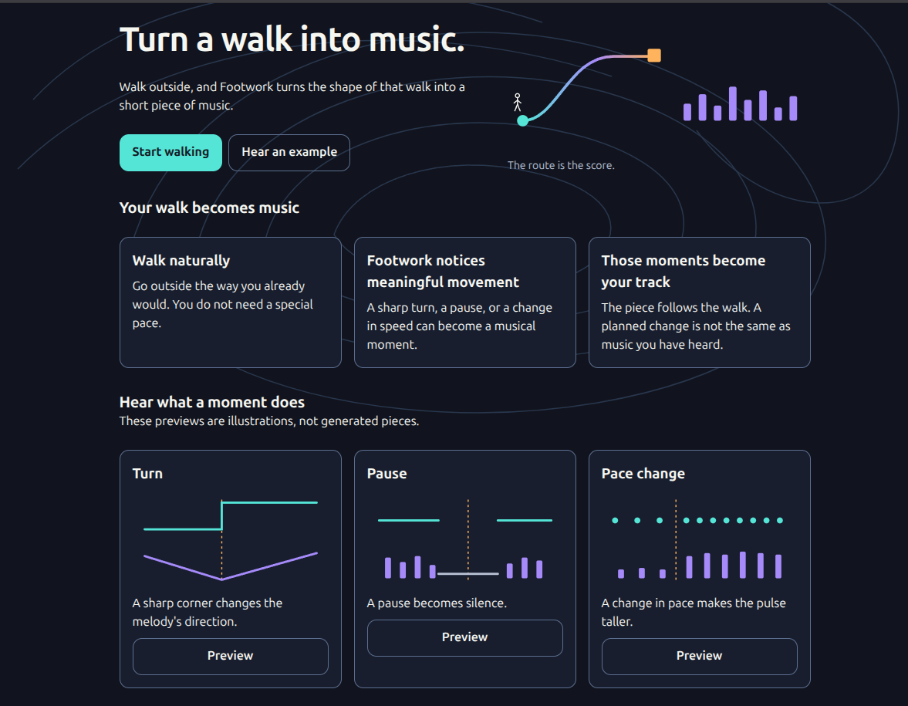

# Footwork



Footwork turns a real walk into a short instrumental track and an interactive
**Soundprint**. Turns, pauses, pace changes, and loops become musical moments,
so the result reflects how the person moved instead of using a generic prompt.

[Open Footwork](https://footwork-m6g0.onrender.com/) ·
[Read the story behind the project](https://dev.to/kernelkain/japan-turning-footsteps-into-electricity-i-turned-them-into-music-4h05)

## What it does

1. The browser records a walk after the person grants location access.
2. The backend cleans the route and finds meaningful movement events.
3. Gemma turns the anonymous event timeline into a structured arrangement.
4. Eleven Music renders the validated arrangement as an instrumental track.
5. The Soundprint plays the result while its route, timeline, and explanations
   stay synchronized to one audio clock.

If music generation is unavailable, Footwork creates a simpler **Route Sketch**
from the same movement timeline. A clearly labeled example is also available
without recording a walk.

## Movement becomes music

| Movement    | Musical response                        |
| ----------- | --------------------------------------- |
| Sharp turn  | The melody changes direction            |
| Pause       | The music holds or becomes quiet        |
| Faster pace | The pulse becomes brighter and stronger |
| Loop        | An earlier musical idea returns         |

Footwork is not a fitness tracker. It focuses on the character of a journey and
shows which moments shaped the music.

## Main features

- Mobile-first outdoor recording with pause and resume
- Light and dark themes with reduced-motion support
- Route cleaning and movement-event detection in Python
- Structured Gemma arrangement plans with strict validation
- Instrumental rendering through Eleven Music
- A synchronized Soundprint with route, movement ribbon, player, and story
- Short-lived share links that do not include location data
- Honest fallbacks when a provider or recording step fails

## Architecture

The React app records and displays the walk. A FastAPI service processes the
route, asks Gemma on Hugging Face for an arrangement, validates the response,
and sends only valid plans to Eleven Music.

See [the architecture guide](Docs/architecture.md) for the full request flow,
service boundaries, and fallback behavior. The editable diagram is
[Docs/diagrams/architecture.excalidraw](Docs/diagrams/architecture.excalidraw).

## Local setup

You need Node.js 22.12 or newer, Python 3.12.12, and
[uv](https://docs.astral.sh/uv/).

Install the frontend and backend dependencies:

```bash
npm ci --prefix frontend
uv sync --directory backend
```

Copy the backend environment template:

```bash
cp backend/.env.example backend/.env
```

Provider values are optional for the local interface and prepared example. Add
them to `backend/.env` to test live generation. Keep that file local and never
commit secrets. Set `GENERATION_ENABLED=true` only when live Eleven Music calls
are intended.

Start the API:

```bash
backend/.venv/bin/uvicorn app.main:app --app-dir backend --host 127.0.0.1 --port 8000
```

In another terminal, start the frontend:

```bash
npm run dev --prefix frontend
```

Open the local URL printed by Vite.

## Checks

```bash
uv run --directory backend pytest
uv run --directory backend ruff check .
npm run typecheck --prefix frontend
npm run lint --prefix frontend
npm run format --prefix frontend
npm test --prefix frontend
```

## Documentation

- [Final product and implementation handoff](Docs/HANDOFF_2.md)
- [Product concept](Docs/PRODUCT_CONCEPT.md)
- [Architecture](Docs/architecture.md)
- [Gemma integration evidence](Docs/evidence/gemma-access.md)
- [Music and hosting evidence](Docs/evidence/music-hosting.md)
- [Real-walk review notes](Docs/evidence/seed-walk-review.md)
- [Hugging Face arrangement service](hf-space/README.md)

## AI-assisted development

[Grok 4.7 High](https://x.ai/) helped implement the project, and ChatGPT 5.6 Sol
helped plan it. The main implementation work is available in the
[Entire agent session](https://entire.io/gh/kernelKain/footwork/session/f8936f3c-df9a-44fd-b63f-60decd70439a).
The project owner reviewed the product decisions and final code.

## License

The application code is available under the [MIT License](LICENSE). The Gemma
checkpoint uses its own Apache-2.0 license. Music made by Eleven Music follows
the provider's terms and is not covered by this repository's MIT license.
